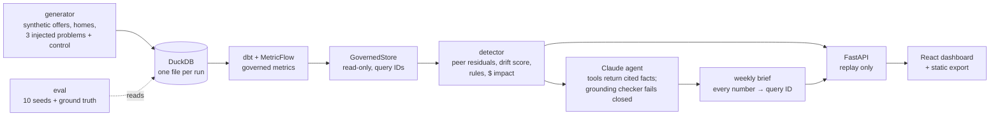

# Margin Radar

**Synthetic data — not Opendoor data.**

An early-warning agent for an iBuyer's contribution margin. Margin is a lagging number: it is computed only on homes that have sold, so a pricing mistake made at purchase shows up months later. Margin Radar watches leading funnel indicators by segment (first-offer rate, contract rate, renovation overrun), separates seasonality from drift by comparing each segment with its peers in the same week, flags adverse selection that looks like "great conversion", ranks actions by dollars of margin at risk, and writes a weekly brief in which every number cites a governed query.

## How it works



- **Deterministic first, LLM second.** The detector computes every number. Claude only chooses among facts its tools return and writes prose. A checker rejects any number in the brief that doesn't exactly match a cited fact, then allows one revision, then fails closed.
- **Seasonality doesn't alert.** The spring peak and the ~500 bps Q2→Q3 margin dip move every segment together, so peer-relative residuals cancel them.
- **The agent abstains.** It writes no LLM brief when history is too short or no alert is active.

## Run it

Requires conda (env `margin-radar`, see `environment.yml`) and Node 22. No API key is needed: the demo, API and dashboard run in replay mode (`REPLAY=1`) from recorded responses and never call Claude.

```bash
make setup     # conda env
make demo      # data → dbt → detector → briefs (replay) → API :8000 + dashboard http://localhost:5173
make export    # pre-render every API response and build the static dashboard into web/dist
make test      # pytest (never makes live API calls)
conda run -n margin-radar python -m pytest -m slow   # the 10-seed sweeps (slow)
make eval      # 10-seed detector evaluation + seed-42 LLM evaluation, replayed → eval/results.md
```

Stop `make demo` before running `make export` or `make build`: DuckDB allows one writer per file, and the API holds the run databases open. A GitHub Actions workflow (`.github/workflows/pages.yml`) builds the static export and deploys it to GitHub Pages. It runs only when started by hand (`workflow_dispatch`), after Pages is enabled in the repository settings. Nothing has been pushed.

Screenshots (light, dark, mobile): `docs/screenshots/`.

## Results

From `eval/results.json`. Detector thresholds were tuned on seeds 1–5; seeds 6–10 are the holdout. Gates are reported as measured and are never loosened. Rates are truncated, never rounded up. The recall gate needs every scenario, so it **fails** in both splits, as do the false-alert and wrong-scope gates. Lead ranges cover only the seeds caught in time.

| Measure | Holdout seeds 6–10 | All seeds 1–10 | Gate |
|---|---|---|---|
| B: adverse selection (B2), caught before margin showed it | 4/5, median lead 9 weeks (8–13) | 5/10, median 8 (7–13) | ≥ 80% of seeds: holdout meets it, all seeds miss |
| C: renovation overrun (M05), caught before margin | 5/5, median lead 8 weeks (7–11) | 9/10, median 8 (5–13) | ≥ 80%: meets it in both |
| A: buyers slow down (M02), caught before margin | 0/5 | 0/10 | ≥ 80%: misses it in both |
| False alerts per week, control run | 0.243 (62/255) | 0.152 (78/510) | 0 alert-weeks: **fail** |
| Wrong-scope alert episodes | 5 (gate ≤ 1) | 8 (gate ≤ 2) | **fail** |

| LLM evaluation (seed 42, final model) | Result | Gate |
|---|---|---|
| Briefs published (weeks 40, 45, 50, 60) | 4/4 | pass |
| Numbers grounded in cited facts | 129/129 (100%) | pass |
| Brief accuracy | every brief 100% of sections, 0 direction errors | pass |
| Top action on an injected scope | 4/4 | pass |
| 20 questions: semantic layer vs raw SQL | 20/20 vs 19/20 | — |
| Abstains on 5 unanswerable questions | 5/5 | pass |
| Cost to record the eval's responses | 157 live calls, $0.3937 estimated | — |

## Limitations

- **Simultaneous all-segment shifts are invisible.** Peer comparison cancels anything that moves every segment at once. A portfolio check catches only abrupt ones.
- **Sample-scale dollars.** Dollar figures are at the synthetic portfolio's ~$1.6B/yr, always shown as sample-scale and in bps. They are never scaled to a real business.
- **Uncalibrated scores.** Detector scores rank how unusual a move is. They are not probabilities.
- **The detector gates fail.** At ~20k offers over 78 weeks (median 2 sales per segment-week), noise is about the size of scenario B, and scenario A sits below the noise floor. See `docs/DECISIONS.md` D16–D17.
- **The holdout is not fully held out.** Scenario scopes and onset week are the same in every seed (only noise varies), and the baseline design was chosen on pooled seeds.
- **Adverse-selection impact is a scenario estimate** (a 1–3% valuation shortfall) until resales confirm it.

## Claude Code skills used, and why

- **brainstorming → writing-plans**: turn the brief into `PLAN.md` before any code.
- **subagent-driven-development** (Phase 2) and **executing-plans** (Phases 3+), with **requesting-code-review** at the end of each phase.
- **test-driven-development**: every feature and fix starts from a failing test.
- **systematic-debugging**: found the frozen-baseline root cause of the control false alerts, and a replay miss caused by unordered SQL.
- **dbt skills** (analytics engineering, semantic layer): governed metrics in MetricFlow.
- **claude-api**: record/replay cache, prompt caching, strict tool schemas, Message Batches for evals.
- **frontend-design** and **webapp-testing**: dashboard design, plus Playwright screenshots in light, dark and mobile (`docs/screenshots/`).

Decisions and their reasoning are in `docs/DECISIONS.md`.

**Synthetic data — not Opendoor data.**
